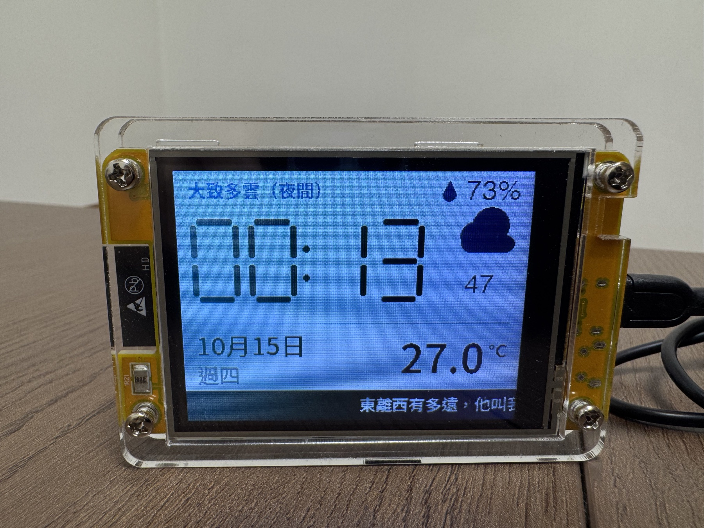
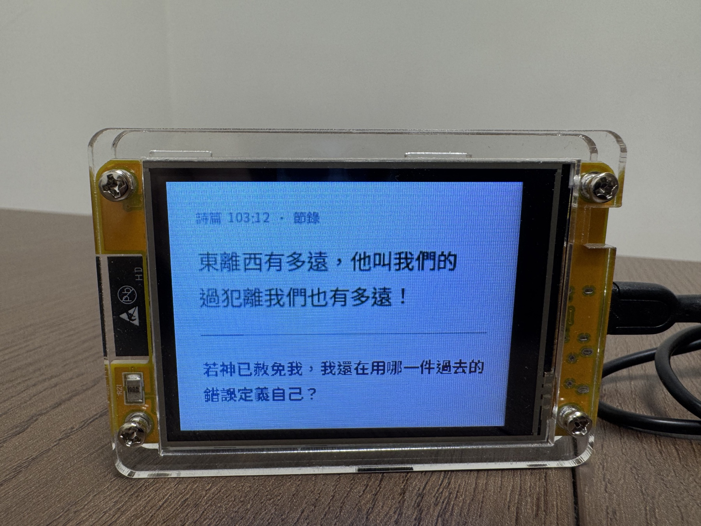
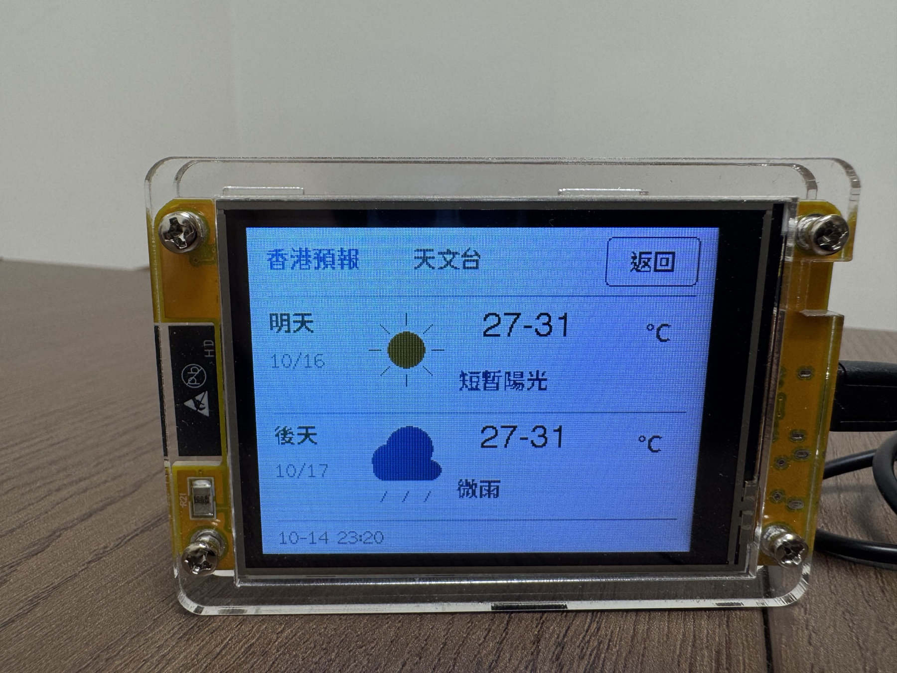

# IGNITE Clock｜燃續日常

**IGNITE LAB｜燃續科技實驗室** · IGNITE 燃續事工

### 每日所需，一眼看見。

**時鐘・天氣・巴士・每日金句與反思**

將香港天氣、巴士到站資訊、每日聖經金句與反思，放進一塊小小的桌面螢幕。

以 **ESP32-2432S028R（Cheap Yellow Display／CYD）** 製作，配合 SD 卡儲存經文、反思及中文字形；連上 Wi-Fi 後自動校時及更新資訊。日常設定可透過手機或電腦瀏覽器修改。

**[開啟安裝網站](https://mikeliu8.github.io/ignite-clock/)** · **[下載 SD 資料包](https://mikeliu8.github.io/ignite-clock/downloads/sd-card-v17.zip)** · **[操作方式](#操作方式)** · **[常見問題](#常見問題)**

> **目前版本：Stage13-v19 · 朋友試用版**
>
> 已在開發板上完成主要功能及畫面操作驗收。另一塊 CYD 的觸控校正、瀏覽器首次安裝及長期穩定性，仍需實機確認。



*實機照片，由專案作者提供，拍攝於 2026 年 10 月 15 日。以下照片中的時間、天氣及日期為拍攝當刻畫面，並非即時資訊。*

## 一眼看見日常所需

| 頁面 | 功能 |
| --- | --- |
| **首頁** | 大型七段數碼時鐘、秒數、日期及「週X」、所選測站氣溫、香港天氣狀況與圖示、天文台濕度，以及完整每日金句滾動文字帶。 |
| **聖經與反思** | 每日一節繁體和合本經文、經文出處，以及與當日選經配對的一條反思問題；全年366日，包含2月29日。 |
| **交通** | 同時顯示三個巴士收藏，每個收藏最多顯示三班預計到站時間；各自設定路線、方向及上車站。 |
| **倒數工具** | 快捷選擇倒數時間，開始、暫停及重設；按「設定」直接顯示網址／PIN／QR Code，右上有 IGNITE Logo。 |

自動輪播只循環 **首頁 → 聖經 → 交通**。第四頁工具及設定畫面由手動開啟，使用時不會自動跳走。

### 每日金句，留一個反思入口



- 經文與反思清楚分開，以不同字級及顏色呈現。
- 問題使用第一人稱，幫助我們回看內心、關係、信任及當天的實際選擇。
- 首頁底部播放當日**完整一節經文及出處**，由右向左滾動；輕按文字帶即可暫停／繼續。
- 首頁輪播會等待整段金句播完；暫停閱讀時不會自動跳頁。

反思是個人默想問題，並非聖經原文或經文譯文。

### 點一下，看明天與後天



首頁輕按天氣圖示，即可開啟兩日預報，查看日期、天氣狀況及最低至最高氣溫；按「返回」後，金句接續原本位置及暫停狀態。

- **首頁氣溫**：使用設定網頁選擇的天文台測站。
- **濕度**：天文台資料，並非所選測站的本地濕度實測值。
- **明天／後天預報**：香港整體預報，並非個別測站或街道預報。
- 尚未取得資料時顯示缺資料狀態，不以示範數字代替。

### 常用巴士，收藏三個就夠

在設定網頁輸入巴士號碼，搜尋路線，再選擇方向及上車站。三個收藏可以使用不同的上車站；交通頁會顯示路線、目的地、上車站及最多三班到站時間。

目前支援**九巴／龍運**公開 API，不是所有香港巴士公司的通用搜尋。

## 開始之前

| 項目 | 本版本基準 |
| --- | --- |
| 開發板 | ESP32-2432S028R／CYD，4MB Flash |
| 螢幕 | 2.8吋；本版本採用 `ILI9341_2_DRIVER` 配置，橫向320 × 240 |
| 觸控 | XPT2046 電阻式觸控 |
| 記憶卡 | FAT32 microSD，用於經文、全年選經、反思及字形 |
| 網絡 | 2.4 GHz Wi-Fi；天氣、校時及巴士資料需要網絡 |
| 安裝電腦 | 建議使用電腦版 Chrome／Edge，配可傳輸資料的 USB 線 |
| 供電 | **只接一個 USB，USB-C 與 Micro USB 不要同時連接** |

> **先確認板型再安裝。** 相似外觀的 CYD 可能使用不同螢幕控制器或硬件 revision；本韌體不保證全部適用。觸控校正來自開發板，另一塊同型板也可能需要重新校正。本板控制器型號未經獨立晶片識別，這裏列出的是已可運作的 driver 配置。

## 安裝：三個步驟

### 1. 準備 SD 卡

下載並解壓 [SD 資料包](https://mikeliu8.github.io/ignite-clock/downloads/sd-card-v17.zip)，把以下資料直接放到 SD 卡**最外層**：

```text
SD 卡最外層/
├── bible/
├── fonts/
│   ├── daily/
│   ├── marquee/
│   ├── reflection/
│   └── …
├── reflections/
└── daily_verses.csv
```

例如，卡上應可找到 `/bible/JHN/003.txt` 及 `/fonts/marquee/10-15.mqf`，不要在外面多包一層 `sd-card` 資料夾。

先關掉 CYD 電源才取卡。複製完成後安全退出記憶卡，再插回 CYD。

### 2. 在網頁安裝韌體

1. 用電腦 Chrome／Edge 開啟 **[IGNITE Clock 安裝網站](https://mikeliu8.github.io/ignite-clock/)**。
2. 以一條資料 USB 線接上 CYD，確認沒有同時接兩個 USB。
3. 閱讀板型及重設提示，勾選確認項目。
4. 按「連接 CYD 並安裝」，選擇 CYD 的 USB 裝置，依畫面完成安裝。

**這是完整新安裝，會取代原有程式，重設板上的 Wi-Fi、巴士收藏及其他設定。** SD 卡內容不受影響。已有其他程式的板，請先保留原程式及設定。

### 3. 設定自己的 Wi-Fi

1. 開機後查看 CYD 畫面上的設定網絡名稱及六位 PIN。
2. 用手機／電腦加入 `CYD-Setup-XXXX` 網絡。
3. **Wi-Fi 密碼是 `CYD-` 加六位 PIN**，不是只有六位數字。例如 PIN 若為 `123456`，Wi-Fi 密碼便是 `CYD-123456`；這只是說明例子。
4. 開啟 `http://192.168.4.1/`，在設定網頁輸入畫面上的六位 PIN，設定自己的2.4 GHz Wi-Fi。
5. 完成後，把手機／電腦接回同一個家中 Wi-Fi。從 CYD 設定頁查看新網址或掃 QR Code，再修改天氣測站、巴士及顯示選項。

PIN 每次重開會改變，請以當時 CYD 畫面為準，不要把 PIN 或 Wi-Fi 密碼放到 GitHub 留言。

## 設定天氣及巴士

左右切到第四頁倒數工具，按「設定」便直接見到網址、PIN 及 QR Code；不再經過選頁表單或 Wi-Fi／天氣／巴士分類畫面。按「返回倒數」回原頁，正在執行的倒數繼續。

**天氣位置**：在 CYD 的設定入口開啟網頁，選擇測站並儲存。預報詳情仍顯示香港整體天氣。

**巴士收藏**：

1. 選擇「收藏1／2／3」。
2. 輸入路線號碼，按「搜尋路線」。
3. 選擇方向及班次種類，再選上車站。
4. 按「選用此站」後，**再按「儲存目前設定」**。
5. 確認顯示「已儲存及讀回核對」；可按「讀取目前設定」再核對收藏。

「已選用此站，尚未儲存到 CYD」只代表網頁已暫存選擇，尚未寫入裝置。

## 日間與夜間模式

本版本支援按香港時間定時切換配色及背光亮度，並非按環境光暗自動感應。

| 模式 | 配色 | 預設亮度值 |
| --- | --- | --- |
| 日間 | 米白底、深色文字 | 255 |
| 夜間 | 深色底、淺色文字 | 60 |

1. 在 CYD 第四頁按「設定」，用同一 Wi-Fi 的手機／電腦開啟畫面網址或掃 QR Code。
2. 輸入畫面 PIN，按「讀取目前設定」。
3. 在「顯示與夜間模式」勾選「啟用定時夜間模式」。
4. 設定夜間開始／結束時間及日夜亮度，再按「儲存巴士、工具及顯示設定」。

出廠預設未啟用；預設夜間時段為 **22:00–07:00**，可自行修改。背光亮度值不是百分比。設定頁 Logo 保留原色及淡色小底板，讓深藍字在夜間仍可辨認。

## 操作方式

| 操作 | 結果 |
| --- | --- |
| 輕按畫面左／右側 | 手動切上一頁／下一頁，包括第四頁工具；同時解除固定 |
| 中央長按約1.5秒 | 固定目前頁面；再長按解除固定。時鐘及資料更新繼續 |
| 輕按首頁金句帶 | 暫停／繼續滾動；暫停時首頁不自動離開 |
| 輕按首頁天氣圖示 | 查看明天及後天天氣預報 |
| 預報頁按「返回」 | 回首頁，接續金句原位置及暫停狀態 |
| 工具頁開始倒數，再進入設定 | 倒數在背景繼續，返回後可查看 |

## 常見問題

### 巴士為何有時「更新失敗」？

目前已知第2／3收藏偶爾在運行一段時間後更新失敗，之後自行恢復；**根本原因仍未確認，不能斷言是 RAM 不足**。有舊資料時會盡量保留並顯示狀態。到站時間只供參考，仍應以巴士公司的最新資訊為準。

### 手機輸入六位數字後，不能加入設定 Wi-Fi？

設定 Wi-Fi 密碼要輸入 **`CYD-` 加六位 PIN**，例如 `CYD-123456`。進入設定網頁後，才在 PIN 欄輸入六位數字。

### 電腦找不到 CYD 的 USB 裝置？

先確認 USB 線可傳輸資料及板型正確。若系統需要 CH340 驅動，請從晶片廠商官方網站取得適合你系統的版本。只接一個 USB，不要同時插兩個接口。

### 顯示顏色、方向或觸控位置不正確？

請先停止操作並確認硬件版本。本程式沿用開發板已可用的顯示及觸控設定，未驗證其他控制器及每一塊 CYD 的觸控校正，不應直接猜 driver 或 GPIO。

### 日後如何更新？

以本 repository 的版本說明及安裝頁為準。**目前提供的按鈕是完整安裝，更新也會重設板上設定**，請先記下自己的測站、巴士及顯示選項。不要把整張個人 SD 卡或 Flash 備份上載到公開 repository。

## 版本及驗證範圍

目前提供 **Stage13-v19**：

- 自動三頁輪播，第四頁工具手動進入。
- 設定網頁 gzip 壓縮，減少 Flash 用量；精簡畫面的設定副本，減少靜態 RAM。
- 點首頁天氣圖示查看明天／後天預報。
- 保留每日滾動金句、366條反思及三個巴士收藏。
- v18：取消選頁及設定分類畫面；中央長按固定／解除，左右切頁解除固定。
- v19：設定頁右上加入64×32正式 IGNITE Logo；不需增加 SD 檔案。
- 定時日夜模式沿用既有功能，本次補充開啟方法，沒有自動替使用者啟用。

目前版本的實際 app 為1,302,528 bytes，程式分區餘8,192 bytes；靜態 RAM 72,300 bytes。Logo 用1,730-byte Flash資料，繪製像素行暫用128-byte stack，另有函式開銷，未量度整個繪製過程的實機RAM增量。

SD資料包仍沿用 `sd-card-v17.zip`，與v19兼容，已有完整資料的卡毋須重新複製。

開發板已確認主要畫面、切頁、金句暫停／接續、兩日預報返回、倒數及設定保存讀回；v18直接設定／固定／解除與v19 Logo可讀性／設定返回／左右切頁亦已由使用者實機確認。安裝網站的 HTTPS、manifest、BIN 及資料包下載亦已核對。

**未由此證明**：所有 CYD 硬件版本相容、另一塊板的瀏覽器首次燒錄、長時間穩定性或所有網絡故障情境。這是朋友試用版，歡迎提供實際問題。

## 檔案及開發資料

| 檔案 | 用途 |
| --- | --- |
| [`index.html`](index.html) | 安裝網站及首次設定說明 |
| [`manifest.json`](manifest.json) | ESP Web Tools 安裝設定 |
| [`firmware-v19.bin`](https://mikeliu8.github.io/ignite-clock/downloads/firmware-v19.bin) | 由v19已燒錄的四個 segment 合併的完整韌體，offset0 |
| [`sd-card-v17.zip`](https://mikeliu8.github.io/ignite-clock/downloads/sd-card-v17.zip) | 經文、全年選經、反思及字形；不含 Wi-Fi 設定 |
| [`firmware-source-v19.zip`](https://mikeliu8.github.io/ignite-clock/downloads/firmware-source-v19.zip) | 此版本的韌體原始碼 |
| [`SHA256SUMS.txt`](downloads/SHA256SUMS.txt) | 下載檔案的 SHA256 |
| [`release.json`](release.json) | 版本及檔案資料 |

開發基準：ESP32 Arduino core **3.3.12**、TFT_eSPI **2.5.43**、XPT2046_Touchscreen **1.4**；FQBN `esp32:esp32:jczn_2432s028r`。安裝工具的識別名稱仍沿用「CYD 時鐘」，版本與BIN已指向v19；作品對外名稱為 IGNITE Clock｜燃續日常。安裝功能使用 ESP Web Tools，日常 Wi-Fi 設定使用 CYD 自己的網頁入口，未加入 Improv Wi-Fi。

## 回報問題

可在 [GitHub Issues](https://github.com/MikeLiu8/ignite-clock/issues) 提供：版本、板型、發生前的操作、完整錯誤文字，以及已遮住敏感資料的畫面。請勿公開 PIN、Wi-Fi 密碼、token 或私人網絡設定。

## 關於 IGNITE Clock

IGNITE Clock｜燃續日常，是 IGNITE LAB 燃續科技實驗室的免費分享作品。

由 Mike 廖牧師運用 AI 協助開發，將日常生活資訊與信仰反思結合，希望透過簡單實用的科技，為生活帶來更多便利，也讓人每天有一個停下來思想信仰的機會。

### 關於 IGNITE 燃續事工

IGNITE 燃續事工致力探索科技、創意與牧養的不同可能，透過 AI 培訓、創新工具及免費資源，幫助更多人善用科技。

**燃點生命・延續使命**

## 資料來源與致謝

- **香港天文台**：即時天氣及香港預報。
- **九巴／龍運公開 API**：路線、站點及預計到站資料。
- **繁體和合本 CUV**：經文來源為 BibleGateway；其版本頁標示在美國為 public domain，並不代表已確認所有司法地區或數位版本的權利狀態。
- **Noto Sans TC**：中文字形，採 SIL Open Font License。
- **Arduino ESP32、TFT_eSPI、XPT2046_Touchscreen、ESP Web Tools**：開發及安裝所用的開源元件。

詳見 [第三方聲明及授權](THIRD_PARTY_NOTICES.md)。本專案不是天文台、巴士公司或上述開源專案的官方產品。照片由專案作者提供；第三方及專案自有內容的權利聲明保持，未因公開 repository 而另行選定通用開源授權。
